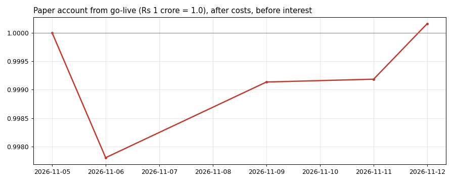

# NIFTY options: a systematic forward test

An automated system that sells NIFTY index options every trading afternoon and hedges the book with NIFTY futures. It is
paper-traded on ₹1 crore with every cost a real account pays. The method is private; this repository publishes its
results, every day, with a fingerprint that proves each day's book was fixed before the market closed.

**Frozen since 5 November 2026.** Nothing in the system learns from results or is refitted: each day it only reads that
day's NSE prices. Any change will be announced here, with its date, before it takes effect.

## How it runs

- **Every trading day from 15:13 IST** it reads NSE's public option chain, decides the day's book and publishes the
  book's SHA-256 fingerprint here, before the close (15:30). A run that fails (a data or network problem) is retried
  every 2 minutes, up to 5 times.
- **The next day** it values that book at the same time on NSE's quotes, records the day's result after costs and
  rebalances.
- **Costs:** sales at the bid and purchases at the ask, exchange and SEBI charges, STT, stamp duty, GST, and the futures
  hedge's own costs. Fills are limited to a share of the traded volume. Brokerage is not included (a firm trading on
  its own exchange membership pays none).
- **No discretion:** nothing is changed by hand. A day the system could not run is shown as a failed run, not filled
  in.

## Results

Trading return on capital after costs, before any interest on the cash.

| Period | Basis | Return / yr | Sharpe | Max drawdown |
|---|---|---|---|---|
| 2008 - 2022, development | backtest on NSE closing prices | +8.1% | 2.07 | -7.1% |
| 2023 - Oct 2026, held out (not used for any design choice) | backtest on NSE closing prices | +11.5% | 2.65 | -5.2% |
| 7 Oct - 2 Nov 2026, fresh (data never seen in development; the system frozen) | NSE closing prices | +1.32% in 18 sessions | too short to annualise | -0.2% |
| From go-live | live, 15:15 IST quotes | see below | | |

The backtests run one persistent account from 2008: compounding capital, positions carried from day to day, partial
fills, margin checked on the book after each day's trades (margin x 1.25 within capital) and futures hedging every
day.

The live account from go-live (updated every day):

## Live record

`records/daily.csv`, one row per trading day: the date the book was decided, its fingerprint, the date it was valued,
its result (% of capital, after every cost), the options' trading costs within that result, the share of capital used
as margin, the account's value, and the day's status: decided, valued, run_failed (no book that day: an execution
problem after 5 attempts) or value_failed (the book could not be valued the next day). A book's result is filled in the
next trading day, when it is valued.

## Why positions are not published

Positions are not published, live or historical, so that the method cannot be copied or learned from its outputs. The
fingerprints prove each day's book was fixed in advance, and any day's book can be shown privately to check it.

## Verifying a day

Each afternoon the system pushes the fingerprint (SHA-256) of that day's exact book before the close. The book itself is not
published; it carries a random nonce, so its fingerprint cannot be matched by trying candidate books. GitHub records the
time of every push on its own servers: see this repository's **Activity** page (the time a commit says it was made is
set by the computer that made it; the push time is GitHub's). So each fingerprint is provably fixed before the close it
is judged on. On request, a day's book can be shown and checked against its fingerprint
(`sha256sum book.json`).

## Limits

- A paper account: fills are simulated at NSE's quoted bid and ask, limited to a share of each option's traded volume,
  not executed with a broker.
- Results are before interest on the cash and exclude brokerage.
- The backtest uses NSE's closing prices; the live record uses NSE's quotes from about 15:15.
- The history of this repository is never rewritten: a rewrite would show on the Activity page as a force push.

## Not investment advice

A research record of a paper-traded system. Nothing here is a recommendation to buy or sell anything.
