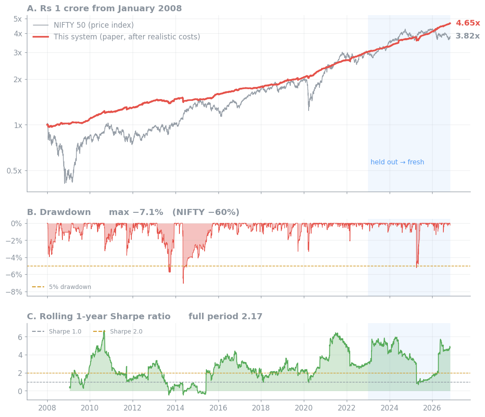
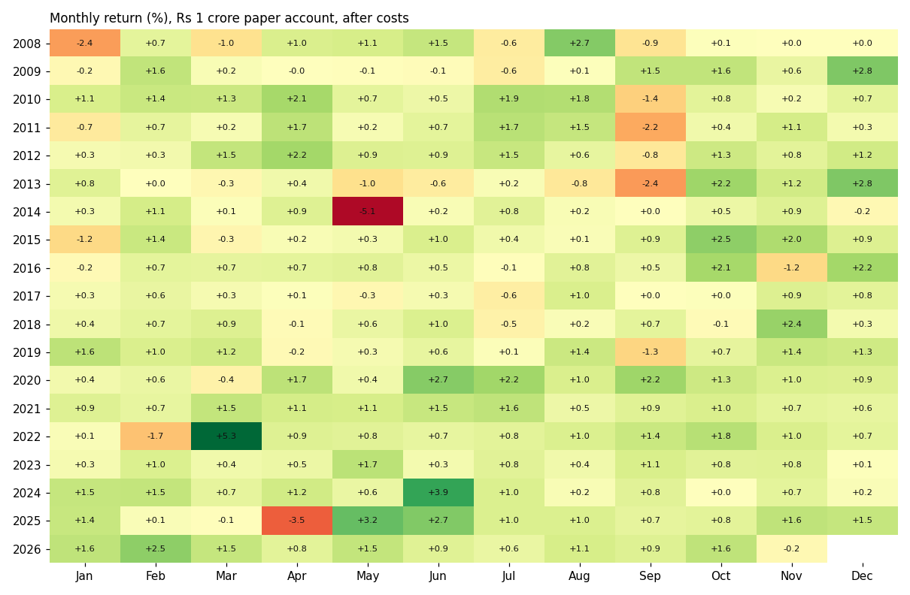

# NIFTY options: a systematic forward test

**An automated options-selling system, run live every trading day, with every decision fingerprinted in public before
the market closes.**

| 18 of 19 | 2.02 · 2.67 | −7.1% | Live |
|:---:|:---:|:---:|:---:|
| years positive, 2008–2026 | Sharpe, development · held out | worst drawdown since 2008 | since 5 Nov 2026 |

**All results are after realistic costs:** bid / ask spreads, exchange and SEBI charges, STT, stamp duty, GST, hedging
costs, and fills capped by each option's traded volume.

## Live

<!-- live:start -->
| Live since | Days valued | Account (paper, Rs) | Return since go-live | Last result | Latest fingerprint |
|---|---|---|---|---|---|
| 05 Nov 2026 | 1 | 9,978,043 | -0.22% | -0.22% (2026-11-05 book, valued 2026-11-06) | `94901274229f...` decided 2026-11-06 at 15:17:39 IST |

*Updated automatically by each day's run. Failed days: 0. Every row: [records/daily.csv](records/daily.csv).*
<!-- live:end -->

## How it runs

- **Every trading day from 15:13 IST** it reads NSE's public data, decides which NIFTY options to sell (hedged with NIFTY
  futures), and publishes the book's SHA-256 fingerprint here before the 15:30 close. A run that fails (a data or network
  problem) is retried every 2 minutes, up to 5 times; if all fail, the day is shown as failed, never filled in.
- **The next day** it values that book on NSE's quotes at the same time, records the result after costs, and rebalances.
- **Costs:** sales at the bid and purchases at the ask, exchange and SEBI charges, STT, stamp duty, GST, and the futures
  hedge's own costs. Fills are limited to a share of each option's traded volume and margin is checked every day.
  Brokerage is not included (a firm trading on its own exchange membership pays none).
- **No discretion.** Nothing is changed by hand, and nothing in the system learns from results.
- **Frozen since 5 November 2026.** Any change will be announced here, with its date, before it takes effect.

## Results

A ₹1 crore paper account run day by day: compounding, positions carried from day to day, partial fills, margin within
capital, futures hedging. After costs, before interest on the cash. Every day counted.

| Period | Return / yr | Sharpe | Max drawdown |
|---|---|---|---|
| 2008 – 2022 · development | +7.7% | 2.02 | −7.1% |
| 2023 – Oct 2026 · held out, not used for any design choice | +11.7% | 2.67 | −5.2% |
| 7 Oct – 2 Nov 2026 · fresh data never seen in development, system frozen | +1.32% in 18 days | – | −0.2% |
| From 5 Nov 2026 · live, NSE quotes at 15:15 | see **Live** above | | |

### Year by year

| Year | Return | Sharpe | Max DD | | Year | Return | Sharpe | Max DD |
|---|---|---|---|---|---|---|---|---|
| 2008 | +2.0% | 0.49 | −3.9% | | 2018 | +6.6% | 2.27 | −1.3% |
| 2009 | +7.5% | 2.85 | −1.9% | | 2019 | +8.5% | 2.24 | −3.3% |
| 2010 | +11.8% | 3.10 | −3.3% | | 2020 | +14.8% | 3.44 | −3.3% |
| 2011 | +5.8% | 1.20 | −3.8% | | 2021 | +12.8% | 5.00 | −0.8% |
| 2012 | +11.3% | 2.96 | −1.5% | | 2022 | +13.4% | 3.07 | −2.1% |
| 2013 | +2.4% | 0.57 | −5.8% | | 2023 · | +8.5% | 4.34 | −1.1% |
| 2014 | −0.4% | -0.04 | −7.1% | | 2024 · | +12.9% | 3.64 | −1.1% |
| 2015 | +8.5% | 3.08 | −1.6% | | 2025 · | +10.8% | 1.63 | −5.2% |
| 2016 | +7.8% | 2.73 | −1.4% | | 2026 · | +13.4% | 4.21 | −1.4% |
| 2017 | +3.4% | 1.76 | −1.0% | |  | | |  |

· held out. 2026 to 2 November.

### On the market's worst days

| Day | Event | NIFTY | This system |
|---|---|---|---|
| 2008-01-21 | Global sell-off | −8.7% | −2.58% |
| 2008-10-24 | Financial crisis | −12.2% | −0.03% |
| 2011-09-22 | Euro-debt sell-off | −4.1% | −3.66% |
| 2015-08-24 | China devaluation crash | −5.9% | −0.13% (21–25 Aug) |
| 2016-11-09 | Demonetisation + US election | −1.3% | +0.27% |
| 2019-09-20 | Corporate tax cut (+5%) | +5.3% | −2.01% |
| 2020-03-12 | COVID crash | −8.3% | −1.95% |
| 2020-03-23 | COVID crash, lower circuit day | −13.0% | −1.04% |
| 2022-02-24 | Russia invades Ukraine | −4.8% | −2.09% |
| 2024-06-04 | Election results | −5.9% | −0.01% |
| 2025-04-07 | US tariff crash | −3.2% | −5.11% |
| COVID crash, 20 Feb - 23 Mar 2020 | | −37.2% | −3.12% |
| Financial crisis, Sep - Nov 2008 | | −36.8% | −0.81% |

Losses are shown as they happened. Sudden large moves are the risk of selling options, and they are in every number
above.

<b>Monthly returns</b>

## Verify it yourself

Each day's book gets a SHA-256 fingerprint, pushed here before the close. GitHub stamps every push with its own server
time (see the repository's **Activity** page; the time a commit says it was made is set by the computer that made it),
so no decision can be changed after the outcome is known. The history is never rewritten: a rewrite would show there
as a force push. Each book carries a random nonce, so its fingerprint cannot be matched by guessing; any day's book
can be shown privately and checked against its fingerprint (`sha256sum book.json`).

## Built to be honest

- **Nothing learns from outcomes:** no part of the system is fitted to which days made or lost money.
- **One chronology:** design choices on 2008–2022 only; 2023 – Oct 2026 held out; then fresh data never seen in
  development; then live.
- **Real frictions:** quoted spreads, every exchange and tax charge, fills capped by traded volume, margin every day.
- **Every day counted:** days the account could not be valued are compounded across, not dropped.

## Why positions are not published

Positions are not published, live or historical, so that the method cannot be copied or learned from its outputs. The
fingerprints prove each day's book was fixed in advance, and any day's book can be shown privately to check it.

## The daily record

`records/daily.csv`, one row per trading day: the decision date, fingerprint, valuation date, result after costs, the
options' trading costs, share of capital used as margin, account value, and status (decided, valued, run_failed,
value_failed).

## Limits

- A paper account: fills are simulated at NSE's quoted bid and ask, not executed with a broker.
- Before interest on the cash and excluding brokerage. The NIFTY line in the chart is the price index, without dividends.
- The backtest uses NSE's closing prices; the live record NSE's quotes at about 15:15. NSE publishes no F&O file for two
  trading days (9 Oct 2013, 30 Mar 2021); the backtest values across them.

---

A research record of a paper-traded system, not investment advice.
