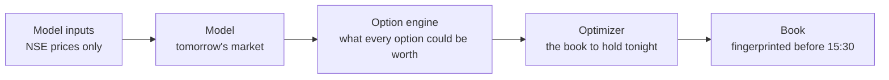
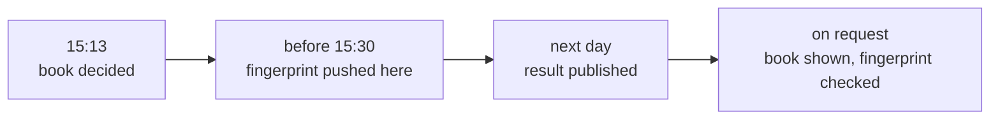

# NIFTY options: a systematic forward test

**An automated system that sells NIFTY index options every afternoon, hedged with futures, and proves every decision in
public before the market closes.**

> 18 of 19 calendar years positive (2008–2026) · 83% of months positive · Sharpe 2.02 in development, 2.67 held out · worst
> drawdown −7.1% since 2008 · live since 5 November 2026, every day's book fingerprinted here before the close

## Live

<!-- live:start -->
| Live since | Days valued | Account (paper, Rs) | Return since go-live | Last result | Latest fingerprint |
|---|---|---|---|---|---|
| 05 Nov 2026 | 0 | 10,000,000 | +0.00% | first result tomorrow | `ef107d7342b7...` decided 2026-11-05 at 15:14:07 IST |

*Updated automatically by each day's run. Failed days: 0. Every row: [records/daily.csv](records/daily.csv).*
<!-- live:end -->

The method is private; this repository publishes its results every day, with a fingerprint that proves each day's book
was fixed before the market closed. **Frozen since 5 November 2026:** nothing in the system learns from results or is
refitted; each day it only reads that day's NSE prices. Any change will be announced here, with its date, before it
takes effect.

## How it works

- **Every trading day from 15:13 IST** it reads NSE's public option chain, decides the day's book and publishes the
  book's SHA-256 fingerprint here, before the close (15:30). A run that fails (a data or network problem) is retried
  every 2 minutes, up to 5 times.
- **The next day** it values that book at the same time on NSE's quotes, records the result after costs, and rebalances.
- **Costs:** sales at the bid and purchases at the ask, exchange and SEBI charges, STT, stamp duty, GST, and the futures
  hedge's own costs. Fills are limited to a share of each option's traded volume. Brokerage is not included (a firm
  trading on its own exchange membership pays none).
- **No discretion:** nothing is changed by hand. A day the system could not run is shown as a failed run, not filled in.

## Results

A ₹1 crore paper account run day by day: compounding, positions carried from day to day, partial fills, margin checked
on the book after each day's trades (margin × 1.25 within capital), futures hedging every day. After costs, before
interest on the cash; every day counted.

| Period | Basis | Return / yr | Sharpe | Max drawdown |
|---|---|---|---|---|
| 2008 – 2022, development | backtest on NSE closing prices | +7.7% | 2.02 | −7.1% |
| 2023 – Oct 2026, held out (not used for any design choice) | backtest on NSE closing prices | +11.7% | 2.67 | −5.2% |
| 7 Oct – 2 Nov 2026, fresh (data never seen in development; the system frozen) | NSE closing prices | +1.32% in 18 sessions | too short to annualise | −0.2% |
| From 5 Nov 2026, live | NSE quotes at 15:15 IST | see **Live** above | | |

### Year by year

| Year | Return | Sharpe | Max drawdown | | Year | Return | Sharpe | Max drawdown |
|---|---|---|---|---|---|---|---|---|
| 2008 | +2.0% | 0.49 | −3.9% | | 2018 | +6.6% | 2.27 | −1.3% |
| 2009 | +7.5% | 2.85 | −1.9% | | 2019 | +8.5% | 2.24 | −3.3% |
| 2010 | +11.8% | 3.10 | −3.3% | | 2020 | +14.8% | 3.44 | −3.3% |
| 2011 | +5.8% | 1.20 | −3.8% | | 2021 | +12.8% | 5.00 | −0.8% |
| 2012 | +11.3% | 2.96 | −1.5% | | 2022 | +13.4% | 3.07 | −2.1% |
| 2013 | +2.4% | 0.57 | −5.8% | | 2023 * | +8.5% | 4.34 | −1.1% |
| 2014 | −0.4% | −0.04 | −7.1% | | 2024 * | +12.9% | 3.64 | −1.1% |
| 2015 | +8.5% | 3.08 | −1.6% | | 2025 * | +10.8% | 1.63 | −5.2% |
| 2016 | +7.8% | 2.73 | −1.4% | | 2026 * | +13.4% | 4.21 | −1.4% |
| 2017 | +3.4% | 1.76 | −1.0% | |  | | | |

\* held out. 2026 runs to 2 November.

### On the market's worst days

| Day | Event | NIFTY | Account |
|---|---|---|---|
| 2008-01-21 | Global sell-off | −8.70% | −2.58% |
| 2008-10-24 | Financial crisis | −12.20% | −0.03% |
| 2011-09-22 | Euro-debt sell-off | −4.08% | −3.66% |
| 2015-08-24 | China devaluation crash | −5.92% | −0.13% (over 21–25 Aug) |
| 2016-11-09 | Demonetisation + US election | −1.31% | +0.27% |
| 2019-09-20 | Corporate tax cut (+5%) | +5.32% | −2.01% |
| 2020-03-12 | COVID crash | −8.30% | −1.95% |
| 2020-03-23 | COVID crash, lower circuit day | −12.98% | −1.04% |
| 2022-02-24 | Russia invades Ukraine | −4.78% | −2.09% |
| 2024-06-04 | Election results | −5.93% | −0.01% |
| 2025-04-07 | US tariff crash | −3.24% | −5.11% |
| COVID crash, 20 Feb − 23 Mar 2020 | whole period | −37.2% | −3.12% |
| Financial crisis, Sep − Nov 2008 | whole period | −36.8% | −0.81% |

Losses are shown as they happened. The worst days since 2008 are 9 May 2014 (−5.2%) and 7 April 2025 (−5.1%). Sudden
large moves are the risk of selling options, and they are in every number above.

## How you can check it

Each afternoon the system pushes the fingerprint (SHA-256) of that day's exact book before the close. The book carries a
random nonce, so its fingerprint cannot be matched by trying candidate books. GitHub records the time of every push on
its own servers: see this repository's **Activity** page (the time a commit says it was made is set by the computer
that made it; the push time is GitHub's). The history is never rewritten: a rewrite would show there as a force push.
On request, a day's book can be shown and checked against its fingerprint (`sha256sum book.json`).

## Built to be honest

- **Nothing learns from outcomes.** No part of the system is fitted to which days made or lost money.
- **One chronology:** design choices on 2008–2022 only; 2023 – Oct 2026 held out; then a fresh period of data never seen
  in development; then live.
- **Real frictions:** quoted spreads, every exchange and tax charge, fills capped by traded volume, margin checked every
  day, a futures hedge with its own costs.
- **Every day counted:** days the account could not be valued are compounded in, not dropped.

## Why positions are not published

Positions are not published, live or historical, so that the method cannot be copied or learned from its outputs. The
fingerprints prove each day's book was fixed in advance, and any day's book can be shown privately to check it.

## Live record

`records/daily.csv`, one row per trading day: the date the book was decided, its fingerprint, the date it was valued,
its result (% of capital, after every cost), the options' trading costs within that result, the share of capital used
as margin, the account's value, and the day's status: decided, valued, run_failed (no book that day: an execution
problem after 5 attempts) or value_failed (the book could not be valued the next day).

## Limits

- A paper account: fills are simulated at NSE's quoted bid and ask, limited to a share of each option's traded volume,
  not executed with a broker.
- Results are before interest on the cash and exclude brokerage.
- The backtest uses NSE's closing prices; the live record uses NSE's quotes from about 15:15. NSE publishes no F&O file
  for two trading days (9 Oct 2013, 30 Mar 2021); the backtest values across them, as an account would.

## Not investment advice

A research record of a paper-traded system. Nothing here is a recommendation to buy or sell anything.
